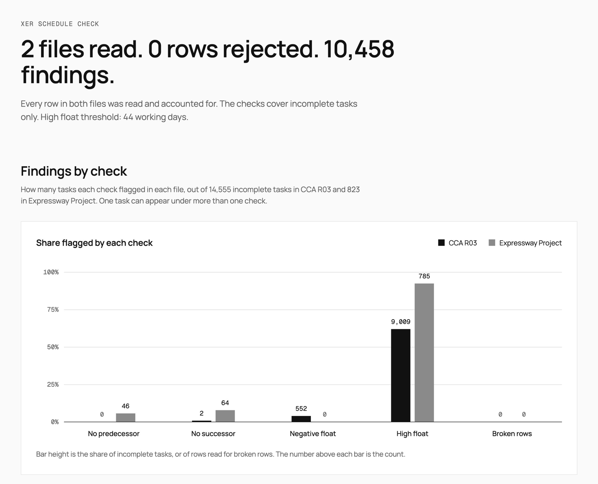

# XER Checker

A command-line tool that reads Primavera P6 schedule exports (.xer), rejects
rows it cannot trust, runs three schedule checks, and writes one static HTML
report. Every finding is traceable to a line in the source file.



Open `report.html` to see the full report.

## Run it

```
npm install
npm run check            # reads every .xer in data/, prints findings, writes report.html
npm test
npm run check:fixture    # runs tests/fixture.xer, writes fixture-report.html (gitignored)
```

Options: `--high-float-days N` (default 44) and `--report PATH`. File paths can
be given instead of using `data/`. Exit code is 0 when the tool did its job,
whatever it found, and 1 when it could not: no files, an unreadable file, a
tally that does not reconcile, checks that could not run, or bad arguments.

Tested on Node 22.23.4, 24.22.2 and 26.8.2. Dev dependencies: typescript, tsx,
`@types/node`. No runtime dependencies.

## Results

Copied from `npm run check` on the two files in `data/`.

| | CCA R03 | Expressway Project |
|---|---|---|
| P6 version | 6.0 | 7.0 |
| Rows read, all tables | 403,177 | 8,551 |
| TASK / TASKPRED / CALENDAR rows | 16,146 / 47,286 / 2 (8 h) | 823 / 1,094 / 2 (9 h) |
| Complete tasks, skipped | 1,591 | 0 |
| Incomplete tasks, checked | 14,555 | 823 |
| No predecessor | 0 | 46 |
| No successor | 2 | 64 |
| Negative float | 552 | 0 |
| High float, over 44 days | 9,009 | 785 |
| Blank float, not evaluated | 0 | 0 |
| Calendar fallback used | 0 | 0 |
| Broken rows, warnings | 0, none | 0, none |

CCA R03 has 552 tasks with negative float; the worst is MGNMI00M07M0 at −104.0
days, line 1407. High float affects 62% of CCA R03's incomplete tasks and 95% of
Expressway's. Expressway's calendars are 9 hours a day: with 8 hours assumed it
would report 787 high-float tasks instead of 785, which is why the tool reads
the calendar instead of assuming.

## The three checks

All checks look only at kept tasks whose `status_code` is not `TK_Complete`.

**Missing links.** A task with no predecessor has nothing controlling its start;
one with no successor cannot pass a delay on. Reported as two counts. Rule: every
incomplete task except `TT_LOE` and `TT_WBS` rows must appear as `task_id` in a
kept TASKPRED row (it has a predecessor) and as `pred_task_id` in one (it has a
successor). Two exceptions: a start milestone (`TT_Mile`) may lack a
predecessor, and a finish milestone (`TT_FinMile`) may lack a successor. Only
kept links count: a rejected TASKPRED row is not a link.

**Negative float.** The task is already late against a required date. Rule:
`total_float_hr_cnt < 0`.

**High float.** Too much slack often points to missing or weak logic. Rule: float
in working days is above the threshold, 44 by default (the DCMA 14-point
assessment), set with `--high-float-days`. Days = hours / the task calendar's
`day_hr_cnt`. If the calendar is missing, or its hours are blank or 0, 8 is
used, and the number of tasks that needed that fallback is reported.

For both float checks a blank `total_float_hr_cnt` means unknown. It is counted
as "not evaluated" and never read as 0.

If a table or column the checks need is missing (TASK, TASKPRED and their
columns; CALENDAR's columns if the table is present), the checks do not run for
that file. The tool says what is missing, exits 1, and never reports 0 for a
check that did not run.

## Broken rows

The parser never stops at the first problem and never drops a row silently.
A rejected row is listed with file, table, line number (1-based) and reason,
and no check ever sees it.

| Rule | Result |
|---|---|
| `%R` field count differs from its `%F` header | rejected |
| `%R` or `%F` before any `%T` | rejected |
| `%R` inside a table that has no `%F` yet | rejected |
| A line that is none of the known types (blank lines are ignored) | rejected |
| TASK row with empty `task_id` | rejected |
| TASK row whose `task_id` was already seen | later one rejected, first kept |
| Non-numeric `total_float_hr_cnt` or `day_hr_cnt` | rejected |
| TASKPRED row whose `task_id` or `pred_task_id` is not a kept task | rejected; the reason says "not in this file (possibly an external link)", or names the rejected TASK row it points at |

A number is valid only if it matches `^-?\d+(\.\d+)?$`. Two file-level
warnings: no `%E` line (file may be cut off), and data after `%E`.

Both real files have zero broken rows, so they cannot prove the detection
works. `tests/fixture.xer` is a hand-made 42-line file with 11 deliberately
broken lines, covering every rule, plus tasks that trigger each check. The tests
assert the exact line number and reason of every one.

## How I checked the numbers

- Every table must reconcile: rows read = kept + rejected. Every line of the
  file lands in exactly one bucket: structural, kept, rejected, blank, or after
  `%E`, and the buckets must sum to the line count. Both are printed and both
  stop the tool with exit 1 if they fail.
- The fixture tests assert exact counts, line numbers and reasons, not just
  that the tool runs.
- `tests/real-files.test.ts` pins every number in the table above, taken from
  a separate awk scan of the files, done before the tool was written, so a
  regression fails the build.
- `report.html` has no timestamp. The same input gives the same bytes: verified
  on Node 22, 24 and 26, and from a fresh clone with `npm install`, `npm test`
  and `npm run check`.

## Limits

- The link check tests that a link exists, not that it is the right one.
- The float checks include milestones and level-of-effort rows.
- Checks run per file, not per project. A file with several projects is
  treated as one schedule.
- Bytes are decoded as windows-1252. Expressway's POBS table holds 176 lines of
  Russian saved in windows-1251, which displays as "Êàòåãîðèÿ". No check reads
  that table. The four other non-ASCII lines in each file are currency symbols.
- The short file labels in the report come from the file name.
- Peak memory is about 450 MB on the 30 MB file. Most of that is transient
  garbage from splitting 400,000 lines; only about 90 MB is retained.

## Sources

Both files come from a publicly shared Google Drive folder of sample P6
schedules, found via Reddit:
https://drive.google.com/drive/folders/1ge9H0n2Nwjge17_P3TQKNPhARbThoR3R
Original author and license unknown. Included unmodified for this exercise
only; removed on request.

| File | Size (bytes) | P6 version (ERMHDR) | SHA-256 |
|---|---|---|---|
| `data/CCA_R03_dt_24Oct11SC.xer` | 30,113,528 | 6.0 | `8f00d46101be2c56e23f761bd9fadfb10471ea77c79cb604f0510c4922a9e7d8` |
| `data/Expressway_Project.xer` | 1,663,465 | 7.0 | `f8efbb5305d3ce36be968ea5c736da194ce144ebad90781191082a43bc886e00` |

To verify: `shasum -a 256 data/*.xer`

## What I would do next

- More DCMA checks: hard constraints, lags, leads, relationship types.
- A streaming parser for very large files.
- Comparing two updates of the same schedule, to show what changed between them.
- Postgres storage for results.
- A web page to upload a file and see the report.
